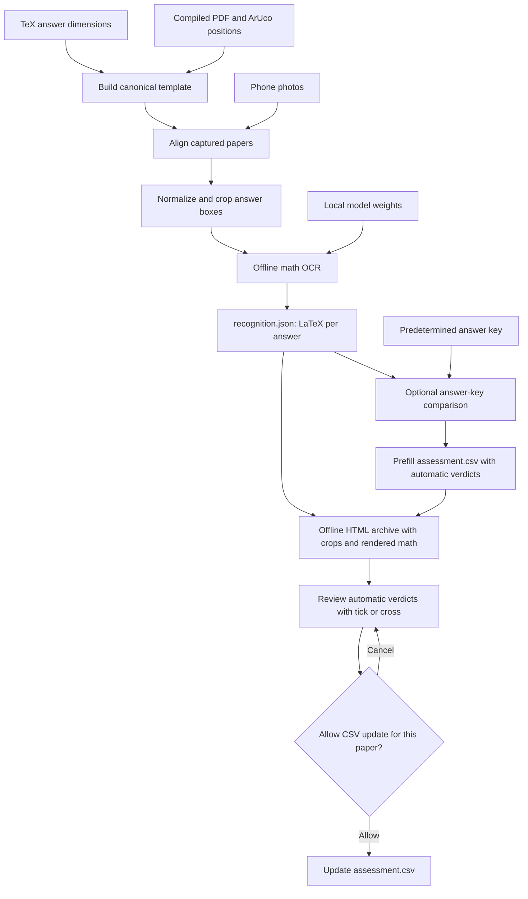
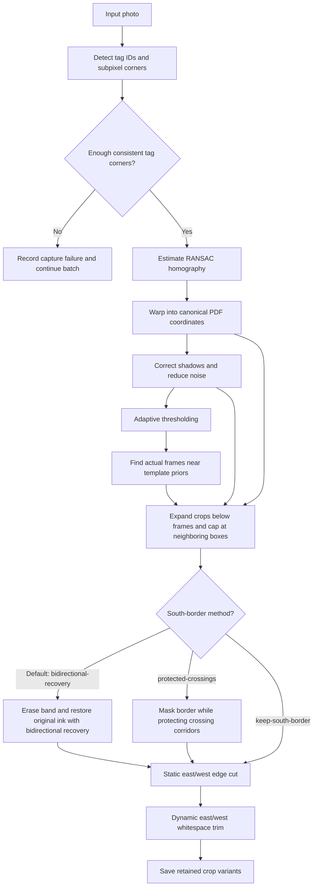
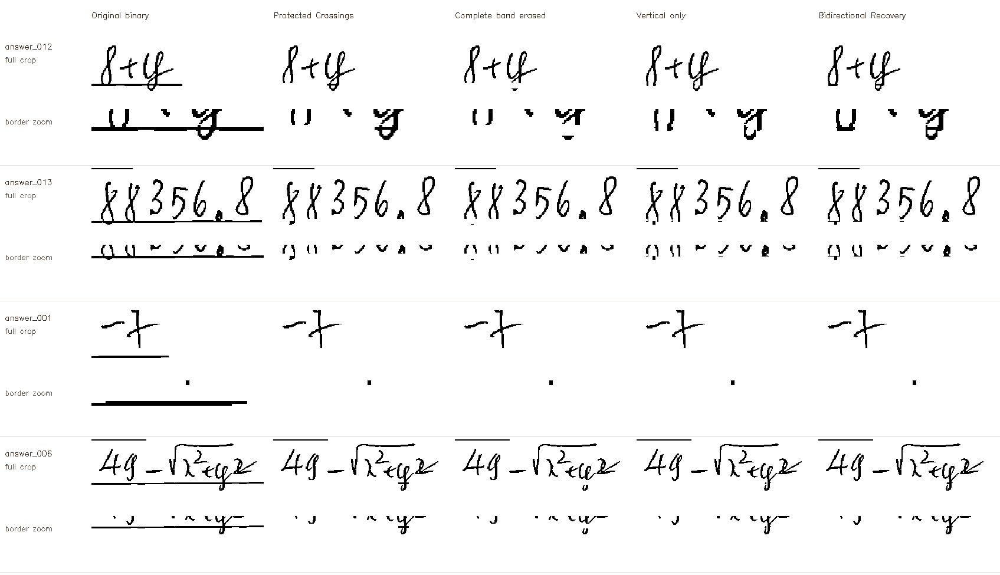

# AutoMarker

A Python starter for processing photographed math quizzes offline: identify answer boxes
from a LaTeX/PDF template, rectify the photographed page with ArUco tags, save answer
crops, recognize formulas as LaTeX, and compare them with a supplied answer key.

## Setup

Python 3.11-3.13 and Git are required; this workspace uses Python 3.12. A local `.venv`
is already created. To reproduce the setup in PowerShell:

```powershell
git init -b main
py -3.12 -m venv .venv
& ./.venv/Scripts/python.exe -m pip install -e '.[ocr,dev]'
```

On Linux/macOS, create the environment with `python3 -m venv .venv` and use
`.venv/bin/python` in the commands below. Environment activation is optional.
For only page alignment and cropping, install `-e '.[dev]'` instead.
Do not install another OpenCV distribution alongside `opencv-contrib-python-headless`;
they share the `cv2` namespace. No GUI, cloud OCR, or LaTeX installation is required.

`requirements-lock.txt` records the installed Windows/Python 3.12 environment. On a
matching machine, install it with `python -m pip install -r requirements-lock.txt`,
then `python -m pip install --no-deps -e .`.

For OCR, provision the model once while online:

```powershell
& ./.venv/Scripts/python.exe -m automarker download-model
```

## Logs, structure, and checks

Every CLI command writes DEBUG logs to `outputs/logs/automarker.log` and INFO logs to
the console. Global flags go **before** the subcommand:

```powershell
& ./.venv/Scripts/python.exe -m automarker --verbose --log outputs/logs/run.log run --help
& ./.venv/Scripts/python.exe -m pytest -q
& ./.venv/Scripts/ruff.exe check src scripts tests
```

```text
src/automarker/    Templates, alignment, OCR, comparison, HTML reports, batch workflow
scripts/          Command wrappers and the optional KaTeX asset update script
configs/          Answer-key examples and configuration
templates/        Generated canonical templates (generated/ is ignored)
models/           Downloaded local weights (ignored)
outputs/          Logs, intermediate images, crops, JSON results (ignored)
tests/            Geometry, parsing, comparison, batch, and offline OCR checks
```

The script wrappers accept the same command-specific arguments as the CLI after an
editable install. Tests using optional local quiz files or model weights skip when
those files are unavailable. Test temporary files and caches are written under `outputs/`.
See `docs/validation.md` for validation results.

## Quick run

After setup, replace these paths with your TeX source, matching tagged PDF, and photo
folder. This one command builds the template, aligns every photo, extracts the answer
boxes, runs OCR using the local model, and opens the quiz reviewer:

```powershell
& ./.venv/Scripts/python.exe -m automarker run --tex C:/quizzes/quiz.tex --pdf C:/quizzes/quiz.pdf --images C:/quizzes/photos --demo-expected --review
```

The browser opens this quiz's **`index.html`** through a local review server. Each source photo has
its own page, such as `archive/photo_001.jpg.html`, with final crops, rendered recognized
math, raw TeX, and expected answers side by side. `archive.zip` contains the portable report.
The HTML is the main review tool: its `assessment.csv` is associated automatically,
automatic verdicts are already filled in, and each answer has ✓ / ✕ correction buttons.
Approve each page's save to persist your review. Stop the server with Ctrl+C when done;
omit `--review` to generate the archive and exit without opening the viewer.
`--demo-expected` supplies made-up expected values clearly labeled as demo content;
replace it with `--key PATH` for your real answer key, or omit both to leave expectations blank.

The default output is `outputs/run/`: the template is in `template/`, and each paper's
machine-readable OCR is in `captures/<photo_stem>/recognition.json` under `answers[].ocr.latex`.
Each capture also includes crops, inspection images, and `extraction.json`;
`captures/summary.json` lists successes and failures. The model loads once for the batch.
Use `--output PATH` to select another output root, `--model PATH` for local model weights,
or `--key PATH` to also write a candidate `comparison.json` for each paper.
The command does not download missing models; run the setup download command first.
Use `--page N` when all input photos represent a particular page of a multipage quiz.
Output is compact by default: the input photo, binary page, actual crop overlay,
selected OCR crops, binary crops, and JSON results. Add `--debug-images` to retain
all intermediate stages, alternate crops, and border masks under each paper's `debug/`.
South-border removal defaults to **Bidirectional Recovery**. Add
`--south-border-method protected-crossings` to use **Protected Crossings**, or
`--south-border-method bidirectional-recovery` to select the default explicitly.
For Bidirectional Recovery, `--horizontal-dilation-width-px 15` gives a 7-pixel reach
in each direction; use another positive span to tune recovery.

## Command-line options

Use `python -m automarker --help` to list commands, or
`python -m automarker COMMAND --help` for that command's options. `-h` / `--help`
is available globally and on every command. Paths below are relative to the working
directory unless absolute. Required options are marked **required**.

Global options go before the command:

| Option | Default | Purpose |
| --- | --- | --- |
| `--verbose` | Off | Also print DEBUG logs to the console. |
| `--log PATH` | `outputs/logs/automarker.log` | DEBUG log file. |

`run` builds the template, extracts photos, runs OCR, and exports the HTML/CSV archive:

| Option | Default | Purpose |
| --- | --- | --- |
| `--tex PATH` | **required** | TeX source defining answer boxes. |
| `--pdf PATH` | **required** | Matching compiled PDF. |
| `--images PATH [PATH ...]` | **required** | Photo files or nonrecursive photo directories. |
| `--output PATH` | `outputs/run` | Root for template, captures, and archive. |
| `--model PATH` | `models/pix2text-mfr` | Provisioned local OCR model. |
| `--key PATH` | None | Real JSON answer key; also writes comparison JSON. |
| `--demo-expected` | Off | Made-up expectations for visualization; mutually exclusive with `--key`. |
| `--dpi N` | `200` | Canonical PDF rendering resolution, from 72 to 600 DPI. |
| `--dictionary NAME` | `auto` | ArUco dictionary, e.g. `DICT_4X4_1000`. |
| `--marker-map PATH` | None | Explicit canonical marker map in PDF points. |
| `--calibration-image PATH` | None | Clear tagged photo for an untagged, single-page PDF. |
| `--page N` | `1` | Template page represented by all input photos. |
| `--inset-mm N` | `0.3` | Interior margin at top/left/right; also bottom if `--south-mm 0`. Nonnegative; `0` keeps the full width. |
| `--box-mode NAME` | `refine` | Search for photographed frames near template coordinates; `template` uses fixed coordinates. |
| `--box-search-mm N` | `2` | Maximum distance of detected frame edges from the template prior; nonnegative. |
| `--south-mm N` | `2` | Expand below the detected/fallback bottom edge; capped at the page edge and before overlapping answer boxes. `0` disables expansion. |
| `--keep-south-border` | Off | Disable southern-border masking in normalized/binary crops; raw crops always retain original pixels. |
| `--south-border-method NAME` | `bidirectional-recovery` | Choose `bidirectional-recovery` (erase and restore crossings) or `protected-crossings` (protect crossing corridors while masking). Ignored when `--keep-south-border` is set or frame detection is uncertain. |
| `--horizontal-dilation-width-px N` | `15` | Positive integer horizontal span for Bidirectional Recovery: 15 reaches 7 pixels each way; 3 reaches 1 pixel each way; 1 selects vertical-only recovery. Measured at template DPI; unused by Protected Crossings. |
| `--tighten-ew` / `--no-tighten-ew` | On | Enable/disable both east/west tightening stages. Applies to every saved crop variant. |
| `--tighten-mode NAME` | `both` | `static` removes a fixed strip; `dynamic` trims redundant whitespace; `both` runs static first, then dynamic. |
| `--static-tighten-mm N` | `1.5` | Nonnegative fixed amount removed from **each** east/west edge in static/both mode, regardless of content. |
| `--tighten-padding-mm N` | `1.5` | Nonnegative whitespace margin retained on each side of detected content in dynamic/both mode. Does not expand beyond the preceding stage. |
| `--debug-images` | Off | Save intermediate stages, border masks, and alternate crop variants under `debug/`. DEBUG text logs are always kept. |
| `--variant NAME` | `normalized` | Crop to retain and use for OCR: `raw`, `normalized`, or `binary`. Binary crops are always kept. |
| `--max-tokens N` | `256` | Positive OCR generation limit per answer. |
| `--review` | Off | Start the local reviewer and open a browser after processing; Ctrl+C stops it. |
| `--port N` | `8765` | Local review port when `--review` is enabled. |

The individual commands reuse these options with the following required inputs and defaults:

| Command | Options |
| --- | --- |
| `build-template` | **Required:** `--tex PATH`, `--pdf PATH`, `--output PATH`. Optional: `--dpi 200`, `--dictionary auto`, `--marker-map PATH`, `--calibration-image PATH`, as described above. |
| `extract` | **Required:** `--template PATH` (generated template JSON), `--images PATH [PATH ...]`. Optional: `--output outputs/captures`, `--page 1`, `--inset-mm 0.3`, `--box-mode refine`, `--box-search-mm 2`, `--south-mm 2`, `--keep-south-border`, `--south-border-method bidirectional-recovery`, `--horizontal-dilation-width-px 15`, `--variant normalized`, `--debug-images`, `--tighten-ew` / `--no-tighten-ew`, `--tighten-mode both`, `--static-tighten-mm 1.5`, `--tighten-padding-mm 1.5`, as described above. |
| `download-model` | `--output models/pix2text-mfr` (model destination), `--revision main` (Hugging Face branch, tag, or immutable commit to download). Requires internet. |
| `recognize` | **Required:** `--extraction PATH` (one paper's extraction JSON). Optional: `--model models/pix2text-mfr`, `--variant normalized`, `--max-tokens 256`, as described above. |
| `compare` | **Required:** `--recognition PATH` (OCR JSON), `--key PATH` (answer-key JSON), `--output PATH` (comparison JSON destination). |
| `report` | **Required:** `--captures PATH` (one capture or a batch directory). Optional: `--output outputs/archive`, `--key PATH` or `--demo-expected` (mutually exclusive). No OCR is rerun. |
| `review` | **Required:** `--archive PATH` (generated archive directory). Optional: `--port 8765`, `--open` (open the browser automatically; off by default). |

At 200 DPI the former 1.5 mm inset removed 12 pixels from each edge, shrinking a
71-pixel-high box to 47 pixels. The new default uses a 2-pixel top/side inset and adds
16 pixels below the lower frame edge, subject to neighboring-box/page limits. To
reproduce the old crop geometry, use `--box-mode template --south-mm 0 --inset-mm 1.5`.
Changing crop options requires regenerating crops and OCR, then the report.

## HTML review archives

To make the same report from existing extraction and OCR results without rerunning OCR:

```powershell
& ./.venv/Scripts/python.exe -m automarker report --captures outputs/captures --output outputs/archive --demo-expected
```

`--captures` accepts a batch folder or one paper's output folder. Paper pages retain the original image filename plus
`.html`. Each row places the normalized crop and expected formula beside the review
controls. The recognized LaTeX column is **hidden by default on each paper**. Use
**Show recognized LaTeX** to reveal its rendered formulas and raw TeX, or **Hide
recognized LaTeX** to hide it again. This view control also works when opening HTML
directly and does not change OCR results or the assessment CSV. Expand **Other crop
versions** to inspect retained alternate crops. Raw alternates are available with
`--debug-images` or when `--variant raw` was selected. Papers without OCR explicitly say so;
the report never invents recognized text.

The output includes `archive.json` with page names and counts, `expected.json` with the
expected values used, `assessment.csv`, and `outputs/archive.zip` for sharing. Demo expectations carry
`"demo": true` and a prominent warning on every page. For real expectations, pass
`--key configs/your_answer_key.json` instead. JSON comparisons remain review candidates.

### Review and save assessments

Start the reviewer for an existing archive:

```powershell
& ./.venv/Scripts/python.exe -m automarker review --archive outputs/archive --open
```

The offline server binds to `127.0.0.1:8765` and uses only this archive's
`assessment.csv`. Use `--port NUMBER` if another reviewer is already using that port.
There is no CSV linking step or file picker.

1. Open a paper from this quiz's index. Each answer shows its **Auto: Correct** or
   **Auto: Incorrect** verdict, with the corresponding ✓ or ✕ button selected.
2. Confirm or override the decision with **✓ Correct** or **✕ Incorrect**, and optionally
   add notes. The CSV is unchanged while you edit.
3. Click **Save page** or **Save & next**. Read the paper-specific confirmation and click
   **Allow CSV update**.
4. Each paper requires a fresh confirmation. Cancelling leaves the CSV untouched and
   keeps your edits on the page.

The Next paper link also asks permission to save before moving on. Navigation away from
unsaved edits is guarded; closing/reloading a dirty page shows the browser's unsaved-changes
warning. **Reload saved verdicts** discards the draft only after confirmation and reads the
current CSV. The index shows correct/incorrect totals and the number of answers a human
has reviewed, using this quiz's CSV automatically.

One CSV row represents one answer. `source_image`, `page`, and `answer_id` identify it;
`recognized_latex`, `expected_latex`, `demo_expected`, and `suggested_verdict` retain the
machine context. `auto_verdict` stores the initial binary decision, and `verdict` starts
with that same decision immediately after a quick run. `notes` and `reviewed_at` (UTC ISO
timestamp) remain empty until a reviewer approves a page save. Human corrections change
`verdict` and preserve `auto_verdict`. Missing expected answers leave both verdicts blank;
choose ✓ or ✕ manually before saving. Demo expectations also produce automatic verdicts,
but remain prominently labeled as made-up values and are unsuitable for real grading.
TeX and notes are stored as literal text, with reversible apostrophe escaping for
spreadsheet formula prefixes. Import TeX columns as text when working in spreadsheet apps.

Each approved save rereads the current file, preserves other papers and extra columns,
and updates only the current paper's rows. Conflicting edits to the same paper from another
tab stop the save and require reloading. Regenerating unchanged reports preserves the
CSV byte for byte. Older CSVs gain automatic verdicts while retaining existing reviewer
decisions and notes. Changed OCR or expected values receive a distinct `archive_id`, so
old decisions are not silently applied to a different assessment version.

The ZIP is a snapshot; saving a review updates this quiz's CSV on disk, not the ZIP.
Rerun the `report` command to package the latest saved CSV for sharing. Keep the HTML
pages and `assessment.csv` together when transferring a review.

Each HTML page embeds its crop images, math renderer, and fonts, so even an individual
page works after copying it elsewhere. ZIP files need to be extracted before opening
`index.html`. Opening the HTML directly displays the saved snapshot; saving corrections
requires the local `review` command above. No internet connection, CDN, or extra Python
report library is required. Math is rendered with bundled [KaTeX](https://katex.org/docs/browser);
unrenderable OCR retains its raw TeX with an explicit preview fallback.

For optional browser regression checks, install Node.js, Chrome, and the Node Playwright
package, then set `AUTOMARKER_BROWSER_TESTS=1` before running pytest. If needed, set
`AUTOMARKER_NODE` to the Node executable and `AUTOMARKER_PLAYWRIGHT` to the Playwright
module directory. The check uses isolated browser test files; it never changes your
assessment CSV or requires internet access.

KaTeX's MIT license and release provenance are included in `src/automarker/assets/katex/`.
Maintainers can refresh the pinned assets while online with
`python scripts/vendor_katex.py --version 0.19.0`; the script checks npm's SHA-512 package
integrity. Generating or opening reports never downloads assets.

## Pipeline



The image processing stages retain compact inspection images by default; add
`--debug-images` to save all intermediate stages:



## Build the template

```powershell
& ./.venv/Scripts/python.exe -m automarker build-template `
  --tex C:/quizzes/quiz.tex `
  --pdf C:/quizzes/quiz.pdf `
  --output templates/generated/quiz/template.json
```

The parser reads **empty `tcolorbox` environments with explicit `width` and `height`**
in cm, mm, TeX pt, PDF bp, or inches. Nonempty instruction boxes are ignored.
Dimensions come from `.tex`; absolute positions come from matching vector path bounds
in the compiled PDF, in page/row/left-to-right order. Source text alone cannot determine
TeX's final pagination and box positions. Use a PDF compiled from the same source.
Macros, included TeX files, nested environments, raster PDFs, and automatically sized
boxes need a later parser extension; unsupported or inconsistent layouts fail explicitly.

The manifest stores PDF-point and pixel box coordinates, canonical marker corners,
rendering DPI, page sizes, and source SHA-256 hashes. `page_001_boxes.png` and
`page_001_markers.png` show the detected layout. Inspect these before processing a batch.

For an older **untagged PDF** with tags subsequently added to the printed paper, add
`--calibration-image path/to/clear_tagged_photo.jpg`. SIFT matches printed content to
the PDF once and establishes tag positions. Review `calibration_matches.png` and the
marker overlay. This convenience mode supports single-page PDFs. An explicit
`--marker-map path/to/map.json` is also supported; its format is:

```json
{
  "dictionary": "DICT_4X4_1000",
  "pages": {
    "1": {
      "0": [[20,20],[60,20],[60,60],[20,60]],
      "1": [[550,720],[590,720],[590,760],[550,760]]
    }
  }
}
```

These are illustrative coordinates, in **top-left PDF points**, with each tag's corners
in OpenCV's decoded marker order. Do not sort marker corners by screen position.
Auto-detection searches the 4x4, 5x5, 6x6, and 7x7 1000-tag families plus ArUco Original;
use `--dictionary DICT_4X4_50`, for example, to select a specific dictionary.

## Align and extract

```powershell
& ./.venv/Scripts/python.exe -m automarker extract `
  --template templates/generated/quiz/template.json `
  --images C:/quizzes/photos `
  --output outputs/captures
```

`--images` accepts one or more files or nonrecursive directories. For multipage
templates, process photos of each page separately with `--page N`. This version does
not infer the page number; use distinct marker IDs on each page to avoid confusion.

Processing uses subpixel ArUco corners, an ID-matched RANSAC homography, perspective
warping, morphological illumination correction, mild nonlocal-means denoising, and
adaptive thresholding. It requires at least two shared, spatially separated tags;
inconsistent tag geometry or answer regions outside the photo reject that capture.
Batch processing continues and returns a nonzero exit code if any capture fails.

Each capture directory normally contains:

| File | Purpose |
| --- | --- |
| `01_input.png` | Original decoded photo |
| `02_binary.png` | Adaptive-thresholded aligned page |
| `03_boxes.png` | Actual crop boundaries, including downward expansion |
| `crops/answer_001_normalized.png` | Normalized preview with removed south-border pixels shown in red; OCR uses a temporary clean copy. `--variant raw` saves `_raw.png` instead. |
| `crops/answer_001_binary.png` | Binary crop; saved once if `--variant binary` is selected |
| `extraction.json` | Crop paths, coordinates, homography, inliers, reprojection error |
| `recognition.json` | OCR results after `run` or `recognize` |
| `comparison.json` | Optional comparison when `run --key PATH` is supplied |
| `failure.json` | Error details if a capture fails |

For a successful 13-answer quick run this is **31 files per paper**, or 32 with a
comparison JSON. To match the raw/binary crop pair, use `--variant raw` on `run` or
`extract`. The HTML viewer displays the chosen OCR crop. Add `--debug-images` for:

| Debug file | Purpose |
| --- | --- |
| `debug/02_illumination.png` | Shadow-corrected source photo |
| `debug/03_markers.png` | Detected tag IDs and corners |
| `debug/04_aligned.png` | Aligned color page |
| `debug/05_normalized.png` | Normalized grayscale page |
| `debug/07_template_boxes.png` | Original template box boundaries |
| `debug/08_refined_boxes.png` | Detected frames and template fallbacks |
| `debug/10_border_mask.png` | Removed border pixels, shown in white |
| `debug/11_border_removed.png` | Normalized page after masking |
| `debug/crops/answer_001_*.png` | Alternate crop variants, unmasked normalized crop, and removal mask |

Successful reruns remove obsolete known stage images and unused variants for the
current answers, including images from the older layout. Other files are retained.
Existing outputs are left as they are until rerun. Text DEBUG logging is independent
of `--debug-images` and remains enabled for every command.

Normalized PNGs show the applied south-border removal mask in **red**, including in
the HTML viewer. Only removed pixels are colored; protected crossing strokes retain
their original grayscale values. The `normalized_overlay` field identifies these
previews in extraction and recognition JSON. OCR restores their red pixels to white
in a temporary clean PNG and deletes that file afterward, including on failure. This
adds no permanent files and leaves the colored review preview unchanged. Binary crops
remain clean and raw crops retain original pixels. If masking is disabled or no reliable
frame is detected, no red overlay is drawn. Regenerate existing crops/reports to see it.

East/west tightening has two stages after thresholding and southern-border masking.
Both are enabled by default for `run` and `extract`, in this order:

1. **Static** cuts a fixed 1.5 mm from each east/west edge (12 pixels at 200 DPI).
   It removes edge artifacts without inspecting content. This cut is additional to
   `--inset-mm`; reduce it if writing reaches an edge. A cut that would empty a crop
   fails explicitly instead of silently producing an invalid image.
2. **Dynamic** measures foreground in the statically trimmed crop, removes redundant
   whitespace, and keeps 1.5 mm padding around the writing. It never restores pixels
   discarded by static tightening. Higher dynamic padding retains more space.

Append these options to your existing `run` or `extract` command:

| Behavior | Options |
| --- | --- |
| Static only | `--tighten-mode static --static-tighten-mm 1.5` |
| Dynamic only | `--tighten-mode dynamic --tighten-padding-mm 1.5` |
| Static, then dynamic (default) | `--tighten-mode both --static-tighten-mm 1.5 --tighten-padding-mm 1.5` |
| Disable both stages | `--no-tighten-ew` |

The dynamic stage excludes a confidently detected
printed frame on a measurement copy, including rounded corners; raw pixels
are not painted over. Small disconnected marks, dots, and minus signs are retained.
Residual noise or an uncertain frame can limit how much whitespace is removed. Ink
inseparable from a frame can make the estimated limits uncertain; use a larger margin
when writing touches a border.

All retained variants use the same new horizontal bounds, while the north/south limits
stay unchanged. Dynamic tightening leaves blank crops at their current width; static
tightening still applies its fixed cut to blank crops. No extra files are generated.
`03_boxes.png` shows the final limits. Each answer's `pre_tighten_bbox_px`,
`post_static_bbox_px`, and `bbox_px` in `extraction.json` record the three rectangles;
`static_tighten_ew_px` and `dynamic_tighten_ew_px` record each stage's cuts, while
`tighten_ew_px` records the total. Regenerate extraction, OCR, and the report
to apply it to existing results.

`summary.json` records successful and failed captures. Template coordinates guide a
local search for four printed frame edges in each aligned photo. Uncertain detections
fall back to the template coordinates and leave the southern border unmasked. The
extraction JSON records template/frame/crop coordinates, edge support, detected lines,
expansion limits, and removed-pixel counts. All retained crop variants share the same area.

The default 0.3 mm inset trims the top and sides; 2 mm of downward expansion includes
descenders crossing the bottom edge. Expansion stops before another answer box with
overlapping horizontal extent and at the page boundary. A mask removes the detected
southern border for normalized OCR and binary crops. **Bidirectional Recovery** is
the default: it erases the band, dilates vertically, and uses left/right overlap to
select original ink to restore. **Protected Crossings**, selected with
`--south-border-method protected-crossings`, masks the border while protecting narrow
corridors where ink continues on both sides. `crop_options` in `extraction.json` records
the selection and horizontal span. Each answer's `south_border` records its method,
whether masking was applied, and the recovery geometry when used.
With `--debug-images`, raw and unmasked crops retain all
original strokes for inspection. Identical ink coinciding with the border cannot always be separated;
this is a conservative heuristic, so inspect the masks before relying on OCR. Use
`--keep-south-border` to disable masking. Nearby instructions outside answer boxes can
enter expanded crops; reduce `--south-mm` when needed. Shadows and noise can be reduced,
but clipped highlights, severe blur, folded paper, and curved pages cannot be repaired
reliably by a planar homography. Lens-distortion correction is not implemented yet.

## South-border removal methods

This comparison from the real photos shows the original binary, **Protected
Crossings**, complete band erasure, vertical-only recovery, and **Bidirectional
Recovery**. Each example includes the whole crop and a magnified border strip.



The image is kept in Git as documentation. Both methods are available through
`run` and `extract`. Use `--south-border-method protected-crossings` for the
original method or `--south-border-method bidirectional-recovery` for the default.
`--horizontal-dilation-width-px N` adjusts Bidirectional Recovery reach (default `15`,
giving 7 pixels left and right). Use `3` for the earlier 1-pixel reach, `1` for
vertical-only selection, or `9` for a 4-pixel reach on each side. These distances are
pixels at the template DPI.

The reusable function `southern_dilate()` in `src/automarker/regions.py` keeps the
detected lower-edge position and estimates thickness from two end portions of that
edge: **10–25% from the left and 75–90% from the left**, avoiding the corners and
central writing. It measures contiguous vertical ink runs in each portion, computes
each portion's arithmetic mean, and uses the larger mean. Runs reaching the search
limit (0.6 mm per direction, at least 2 pixels) are excluded. If only one portion has
usable runs, that portion is used; neither gives a 1-pixel thickness fallback.
The mask retains the existing rounding, one-pixel guard, and DPI-based size cap.
The selectable Protected Crossings function `southern_mask()` uses its median estimator.

The new method erases the whole band and applies a vertical one-column dilation
kernel in a strip extending **7 pixels above and below the removal band**. It then
independently dilates the vertical mask **7 pixels left and 7 pixels right**, each
including the source pixels (a total horizontal span of 15 pixels). This larger reach
recovers wider curved crossings, such as the lower loop of an 8. After clipping both
to the strip, it adds them using **uint16** and thresholds at **sum > 255**. Only pixels
supported by both directional masks survive; one-sided outer rims are rejected, while
short gaps between strokes can be filled. The thresholded selection is intersected
with the original ink. It restores
only those original pixels inside the erased band. Foreground outside the band is
unchanged; no new ink pixels are introduced. `strip_padding_px` can adjust the 7-pixel
extension. `horizontal_dilation_width_px` adjusts the total horizontal span; use `1`
for vertical-only selection. The result includes `vertical_recovered_ink` for the
vertical-only recovery and `thickness_estimate` with both sample
ranges, counts, and mean widths; `vertical_dilation_mask` and `dilation_mask` allow
inspection before and after the horizontal overlap threshold. `left_dilation_mask`,
`right_dilation_mask`, `horizontal_dilation_sum`, and `horizontal_union_mask` expose
the directional stages and the previous union expansion, alongside the intermediate
images and removal/restoration masks. The default kernel height is the masked band height plus two pixels,
so the two sides can bridge the removed gap. Pass `dilation_height_px` to test another
height; a centered kernel exactly equal to the band height can leave a one-pixel central
gap. The selection can still restore nearby printed border fragments where they
overlap the original ink. The `run` and `extract` commands apply the selected method;
rerun OCR and the report after changing it.

## Provision and run math OCR offline

The backend is [Pix2Text-MFR](https://huggingface.co/breezedeus/pix2text-mfr), a
mathematical formula recognizer that outputs LaTeX. It runs with ONNX Runtime on CPU.
Its model card includes printed and handwritten examples; that does not establish
accuracy on this quiz or real student handwriting. No accuracy claim is made without
labeled answer crops. Review recognized answers before assigning marks.

Download dependencies and weights **once while online**:

```powershell
& ./.venv/Scripts/python.exe -m automarker download-model --output models/pix2text-mfr
```

This resolves an immutable Hugging Face revision, downloads ONNX and tokenizer files,
and records the revision in `automarker_model.json`. These ONNX weights occupy about 112 MiB;
they are excluded from Git. To use the same model later, pass the recorded commit
to `download-model --revision COMMIT`. Provisioning downloads public model files;
it does not upload quiz images.

Then recognize a capture without internet:

```powershell
& ./.venv/Scripts/python.exe -m automarker recognize `
  --extraction outputs/captures/photo_001/extraction.json `
  --model models/pix2text-mfr
```

Inference enforces `HF_HUB_OFFLINE=1`, `TRANSFORMERS_OFFLINE=1`, and
`local_files_only=True`; missing files fail instead of triggering a download.
It writes `recognition.json`. Use `--variant raw` or `--variant binary` to compare
preprocessing; the variant must have been retained during extraction. Re-extract with
that `--variant` or `--debug-images` if it is missing. Use `--max-tokens 256` to set the generation limit. Truncated results
are flagged. Formulas are not executed or evaluated as Python. Mixed prose and
multiline handwriting may need another OCR backend or segmentation.

For a separate air-gapped computer, transfer the project, provisioned `models/`,
and a wheelhouse built for the same OS/Python version. Create a fresh venv there;
venvs themselves are not portable. Install from the wheelhouse using
`pip install --no-index --find-links wheelhouse -e '.[ocr]'`.

## Compare with an answer key

```powershell
& ./.venv/Scripts/python.exe -m automarker compare `
  --recognition outputs/captures/photo_001/recognition.json `
  --key configs/answer_key.example.json `
  --output outputs/captures/photo_001/comparison.json
```

The example key contains **illustrative values**, not the actual solutions. Supply the
correct key for each student's parameter `m`. Exact mode ignores whitespace and outer
dollar delimiters; numeric mode compares finite decimal literals within an explicit
absolute tolerance. Algebraic equivalence, partial credit, and extracting student `m`
are not implemented. All candidate comparisons require review and `final_score` stays
null; this starter does not silently finalize grades from unverified OCR.

## This workspace's host tools

Python and Git were initially absent from `PATH`; setup used the Codex bundled runtime.
The `.venv/Scripts/python.exe` commands above work directly. The bundled Git is at
`%USERPROFILE%/.cache/codex-runtimes/codex-primary-runtime/dependencies/native/git/cmd/git.exe`.
If Git reports different ownership when switching from the sandbox to your own shell,
use a command-scoped exception for this trusted working directory:

```powershell
& "$env:USERPROFILE/.cache/codex-runtimes/codex-primary-runtime/dependencies/native/git/cmd/git.exe" -c "safe.directory=$PWD" status
```

Installing normal Python and Git distributions on `PATH` is recommended for ongoing
development. Recreate `.venv` if the bundled Python runtime is removed or relocated.
