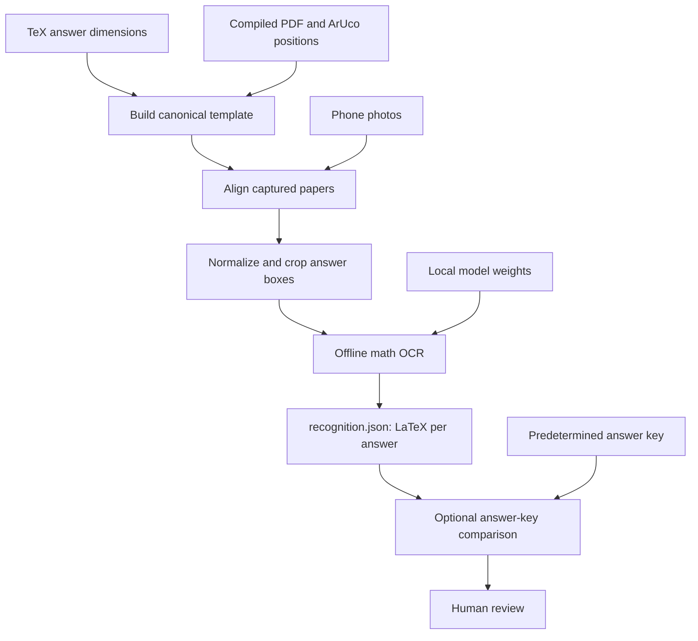
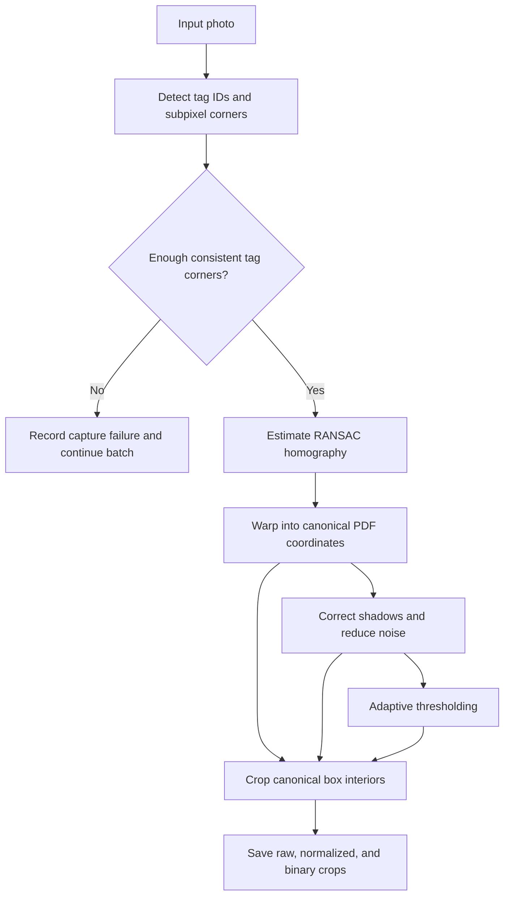

# AutoMarker

A Python starter for processing photographed math quizzes offline: identify answer boxes
from a LaTeX/PDF template, rectify the photographed page with ArUco tags, save answer
crops, recognize formulas as LaTeX, and compare them with a supplied answer key.

## Setup

Python 3.11-3.13 and Git are required; this workspace uses Python 3.12. A local `.venv`
is already created. To reproduce the setup in PowerShell:

```powershell
git init -b main
py -3.12 -m venv .venv
& ./.venv/Scripts/python.exe -m pip install -e '.[ocr,dev]'
```

On Linux/macOS, create the environment with `python3 -m venv .venv` and use
`.venv/bin/python` in the commands below. Environment activation is optional.
For only page alignment and cropping, install `-e '.[dev]'` instead.
Do not install another OpenCV distribution alongside `opencv-contrib-python-headless`;
they share the `cv2` namespace. No GUI, cloud OCR, or LaTeX installation is required.

`requirements-lock.txt` records the installed Windows/Python 3.12 environment. On a
matching machine, install it with `python -m pip install -r requirements-lock.txt`,
then `python -m pip install --no-deps -e .`.

For OCR, provision the model once while online:

```powershell
& ./.venv/Scripts/python.exe -m automarker download-model
```

## Logs, structure, and checks

Every CLI command writes DEBUG logs to `outputs/logs/automarker.log` and INFO logs to
the console. Global flags go **before** the subcommand:

```powershell
& ./.venv/Scripts/python.exe -m automarker --verbose --log outputs/logs/run.log run --help
& ./.venv/Scripts/python.exe -m pytest -q
& ./.venv/Scripts/ruff.exe check src scripts tests
```

```text
src/automarker/    CLI, TeX/PDF templates, alignment, OCR, comparison, batch workflow
scripts/          Thin build_template.py, extract_answers.py, recognize_math.py wrappers
configs/          Answer-key examples and configuration
templates/        Generated canonical templates (generated/ is ignored)
models/           Downloaded local weights (ignored)
outputs/          Logs, intermediate images, crops, JSON results (ignored)
tests/            Geometry, parsing, comparison, batch, and offline OCR checks
```

The script wrappers accept the same command-specific arguments as the CLI after an
editable install. Tests using optional local quiz files or model weights skip when
those files are unavailable. Test temporary files and caches are written under `outputs/`.
See `docs/validation.md` for validation results.

## Quick run

After setup, replace these paths with your TeX source, matching tagged PDF, and photo
folder. This one command builds the template, aligns every photo, extracts the answer
boxes, and runs OCR using the local model:

```powershell
& ./.venv/Scripts/python.exe -m automarker run --tex C:/quizzes/quiz.tex --pdf C:/quizzes/quiz.pdf --images C:/quizzes/photos
```

The default output is `outputs/run/`: the template is in `template/`, and each paper's
OCR text is in `captures/<photo_stem>/recognition.json` under `answers[].ocr.latex`.
Each capture also includes crops, inspection images, and `extraction.json`;
`captures/summary.json` lists successes and failures. The model loads once for the batch.
Use `--output PATH` to select another output root, `--model PATH` for local model weights,
or `--key PATH` to also write a candidate `comparison.json` for each paper.
The command does not download missing models; run the setup download command first.
Use `--page N` when all input photos represent a particular page of a multipage quiz.

## Pipeline



The image processing stages save intermediate images for inspection:



## Build the template

```powershell
& ./.venv/Scripts/python.exe -m automarker build-template `
  --tex C:/quizzes/quiz.tex `
  --pdf C:/quizzes/quiz.pdf `
  --output templates/generated/quiz/template.json
```

The parser reads **empty `tcolorbox` environments with explicit `width` and `height`**
in cm, mm, TeX pt, PDF bp, or inches. Nonempty instruction boxes are ignored.
Dimensions come from `.tex`; absolute positions come from matching vector path bounds
in the compiled PDF, in page/row/left-to-right order. Source text alone cannot determine
TeX's final pagination and box positions. Use a PDF compiled from the same source.
Macros, included TeX files, nested environments, raster PDFs, and automatically sized
boxes need a later parser extension; unsupported or inconsistent layouts fail explicitly.

The manifest stores PDF-point and pixel box coordinates, canonical marker corners,
rendering DPI, page sizes, and source SHA-256 hashes. `page_001_boxes.png` and
`page_001_markers.png` show the detected layout. Inspect these before processing a batch.

For an older **untagged PDF** with tags subsequently added to the printed paper, add
`--calibration-image path/to/clear_tagged_photo.jpg`. SIFT matches printed content to
the PDF once and establishes tag positions. Review `calibration_matches.png` and the
marker overlay. This convenience mode supports single-page PDFs. An explicit
`--marker-map path/to/map.json` is also supported; its format is:

```json
{
  "dictionary": "DICT_4X4_1000",
  "pages": {
    "1": {
      "0": [[20,20],[60,20],[60,60],[20,60]],
      "1": [[550,720],[590,720],[590,760],[550,760]]
    }
  }
}
```

These are illustrative coordinates, in **top-left PDF points**, with each tag's corners
in OpenCV's decoded marker order. Do not sort marker corners by screen position.
Auto-detection searches the 4x4, 5x5, 6x6, and 7x7 1000-tag families plus ArUco Original;
use `--dictionary DICT_4X4_50`, for example, to select a specific dictionary.

## Align and extract

```powershell
& ./.venv/Scripts/python.exe -m automarker extract `
  --template templates/generated/quiz/template.json `
  --images C:/quizzes/photos `
  --output outputs/captures
```

`--images` accepts one or more files or nonrecursive directories. For multipage
templates, process photos of each page separately with `--page N`. This version does
not infer the page number; use distinct marker IDs on each page to avoid confusion.

Processing uses subpixel ArUco corners, an ID-matched RANSAC homography, perspective
warping, morphological illumination correction, mild nonlocal-means denoising, and
adaptive thresholding. It requires at least two shared, spatially separated tags;
inconsistent tag geometry or answer regions outside the photo reject that capture.
Batch processing continues and returns a nonzero exit code if any capture fails.

Each capture directory contains:

| File | Purpose |
| --- | --- |
| `01_input.png` | Original decoded photo |
| `02_illumination.png` | Shadow-corrected photo |
| `03_markers.png` | Detected tag IDs and corners |
| `04_aligned.png` | Color page in canonical PDF coordinates |
| `05_normalized.png` | Corrected grayscale page |
| `06_binary.png` | Adaptive-thresholded page |
| `07_boxes.png` | Answer region overlay |
| `crops/answer_001_{raw,normalized,binary}.png` | Three versions of each answer interior |
| `extraction.json` | Crop paths, coordinates, homography, inliers, reprojection error |
| `failure.json` | Error details if a capture fails |

`summary.json` records successful and failed captures. Crops exclude a configurable
border inset (`--inset-mm 1.5` by default). Reduce this if writing touches the box edges;
inspect raw and normalized variants for lost strokes. Shadows and noise can be reduced,
but clipped highlights, severe blur, folded paper, and curved pages cannot be repaired
reliably by a planar homography. Lens-distortion correction is not implemented yet.

## Provision and run math OCR offline

The backend is [Pix2Text-MFR](https://huggingface.co/breezedeus/pix2text-mfr), a
mathematical formula recognizer that outputs LaTeX. It runs with ONNX Runtime on CPU.
Its model card includes printed and handwritten examples; that does not establish
accuracy on this quiz or real student handwriting. No accuracy claim is made without
labeled answer crops. Review recognized answers before assigning marks.

Download dependencies and weights **once while online**:

```powershell
& ./.venv/Scripts/python.exe -m automarker download-model --output models/pix2text-mfr
```

This resolves an immutable Hugging Face revision, downloads ONNX and tokenizer files,
and records the revision in `automarker_model.json`. These ONNX weights occupy about 112 MiB;
they are excluded from Git. To use the same model later, pass the recorded commit
to `download-model --revision COMMIT`. Provisioning downloads public model files;
it does not upload quiz images.

Then recognize a capture without internet:

```powershell
& ./.venv/Scripts/python.exe -m automarker recognize `
  --extraction outputs/captures/photo_001/extraction.json `
  --model models/pix2text-mfr
```

Inference enforces `HF_HUB_OFFLINE=1`, `TRANSFORMERS_OFFLINE=1`, and
`local_files_only=True`; missing files fail instead of triggering a download.
It writes `recognition.json`. Use `--variant raw` or `--variant binary` to compare
preprocessing, and `--max-tokens 256` to set the generation limit. Truncated results
are flagged. Formulas are not executed or evaluated as Python. Mixed prose and
multiline handwriting may need another OCR backend or segmentation.

For a separate air-gapped computer, transfer the project, provisioned `models/`,
and a wheelhouse built for the same OS/Python version. Create a fresh venv there;
venvs themselves are not portable. Install from the wheelhouse using
`pip install --no-index --find-links wheelhouse -e '.[ocr]'`.

## Compare with an answer key

```powershell
& ./.venv/Scripts/python.exe -m automarker compare `
  --recognition outputs/captures/photo_001/recognition.json `
  --key configs/answer_key.example.json `
  --output outputs/captures/photo_001/comparison.json
```

The example key contains **illustrative values**, not the actual solutions. Supply the
correct key for each student's parameter `m`. Exact mode ignores whitespace and outer
dollar delimiters; numeric mode compares finite decimal literals within an explicit
absolute tolerance. Algebraic equivalence, partial credit, and extracting student `m`
are not implemented. All candidate comparisons require review and `final_score` stays
null; this starter does not silently finalize grades from unverified OCR.

## This workspace's host tools

Python and Git were initially absent from `PATH`; setup used the Codex bundled runtime.
The `.venv/Scripts/python.exe` commands above work directly. The bundled Git is at
`%USERPROFILE%/.cache/codex-runtimes/codex-primary-runtime/dependencies/native/git/cmd/git.exe`.
If Git reports different ownership when switching from the sandbox to your own shell,
use a command-scoped exception for this trusted working directory:

```powershell
& "$env:USERPROFILE/.cache/codex-runtimes/codex-primary-runtime/dependencies/native/git/cmd/git.exe" -c "safe.directory=$PWD" status
```

Installing normal Python and Git distributions on `PATH` is recommended for ongoing
development. Recreate `.venv` if the bundled Python runtime is removed or relocated.
